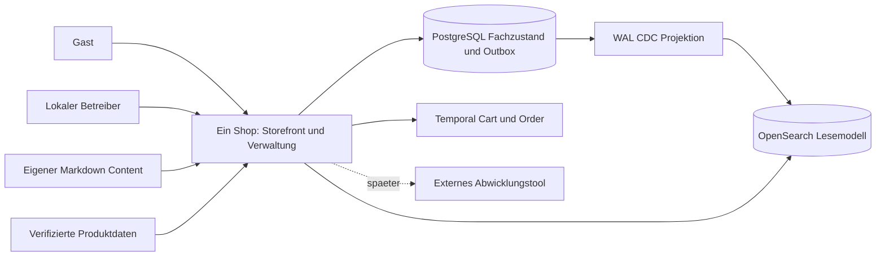

# 3 Kontext und Abgrenzung

Der Gast nutzt öffentliche HTML-Seiten und seinen geschützten Cart/Status. Der lokale Betreiber nutzt /backend ohne Login ausschließlich im lokalen Demo-Netz. Hersteller-/Lieferantendaten werden kontrolliert importiert; EP liefert eine begrenzte öffentliche Sortiments-/Strukturreferenz, keine Laufzeitabhängigkeit.

Im POC ersetzt ein ausdrücklich als Simulation beschrifteter Verwaltungscommand die externe Liefermeldung. Kreditkartenfreigabe ist eine lokale simulierte Activity ohne Kreditkartennummern und ohne fremden Zahlungsdienst. Rechnung hat keinen Zahlungsgateway-Aufruf. Störungen der Suche beeinflussen keinen maßgeblichen Detail-/Kaufzustand.
