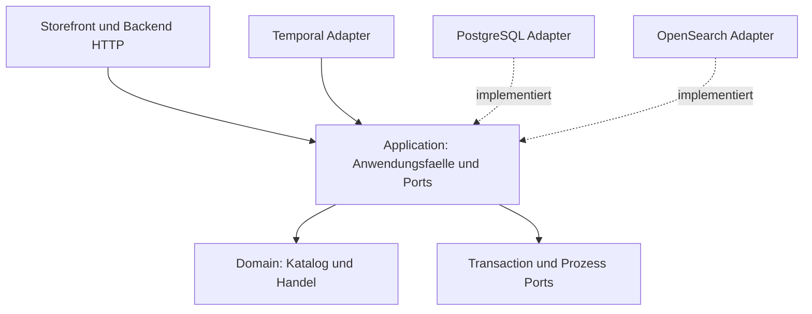

# 5 Bausteinsicht

Die fünf bestätigten Verkaufsroots bleiben Product, Inventory, Cart, User und Order. Ergänzende Konfigurationsroots begründen eigene Konsistenzverantwortung, keine zusätzlichen Verkaufsprozesse. Ein Aggregate enthält Werte und referenziert andere Roots ausschließlich über Kennungen.

- [Typenkatalog](type-model.md): vollständige Go-nahe Ausgangstypen mit folgenden Präzisierungen.
- [Katalog und Werte](catalog.md): Product/Variant, Family/Category, Attribute und Validierung.
- [Handel](commerce.md): Inventory/Cart/User/Order, Geld, Rabatt und Kauf-Snapshots.
- [Pflichtdaten](compliance.md): Datenauflösung und datierte Anwendbarkeitsmatrix.
- [Öffentliche Ports](ports.md): verbindliche Application-/Adapterverträge.
- [Suche](search.md): Varianten, disjunktive Facetten und Ranking.
- [Empfehlung](recommendation.md): nachvollziehbare synthetische Co-Purchase-Statistik.

Geplante kohäsive Packages sind `internal/domain/catalog`, `internal/domain/sale`, `internal/application` und Adapter unter `internal/adapter`. Gemeinsame fachliche Werte dürfen ein kohäsives `value`-Package bilden, kein `utils`. Alle Package-Typen gehören gemäß Styleguide in `type.go`. Konkrete Schnittstellen entstehen aus den nachfolgend verbindlichen Operationen, nicht aus SDK-Abstraktionen.
