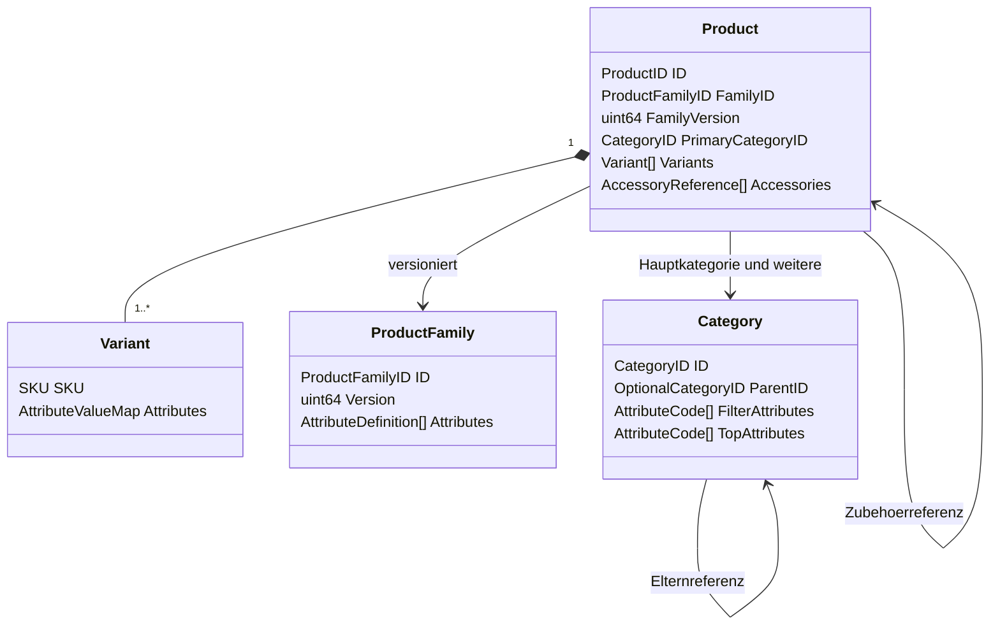

# Katalog und Value Objects

[Typenkatalog](type-model.md) ist die vollständige Datenbasis. Die hier entschiedenen Verfeinerungen ersetzen dessen ausdrücklich als Vorschlag bezeichnete Kommentare. IDs sind nichtleere, maximal 64 Zeichen lange ASCII-Kennungen `[a-zA-Z0-9][a-zA-Z0-9_-]*`; UUIDs sind zulässig. SKU ist case-sensitiv, maximal 64 Zeichen, dasselbe Alphabet. Slugs sind keine Identität. Eindeutigkeit der SKU wird innerhalb Product und transaktional katalogweit über das SKU-Register geprüft. DuplicateSKU ist ein fachlicher Konflikt.

## Roots und Beziehungen

| Root/Wert | Felder und Invarianten |
| --- | --- |
| Product | Alle Felder des Typenkatalogs; ID/FamilyID/Brand/Name und PrimaryCategoryID erforderlich, mindestens eine Variant. Einfacher Artikel genau eine Variant. Zusätzliche Kategorien eindeutig und ohne Hauptkategorieduplikat. Variant übernimmt Kategorien. Keine Preise/Bestände. |
| Variant | SKU erforderlich; GTIN/ManufacturerPartNumber nur bei verifizierten Daten, kein erfundener Identifikator. GTIN vorhandenenfalls gültige 8/12/13/14-stellige Prüfziffer. Attribute auf Variantenebene; Bilder ersetzen gemeinsame Galerie nur, wenn nichtleer. |
| ProductFamily | Eigenständige Konfigurationsroot, weil Attributstruktur unabhängig konsistent publiziert wird. Ergänzung `Version uint64`, positive Version, eindeutige Attribute/Optionscodes. Product bindet zusätzlich `FamilyVersion uint64`; Änderung benötigt Produktvalidierung vor Veröffentlichung, kein stilles Umdeuten gespeicherter Werte. |
| Category | Eigene Konfigurationsroot mit `Version uint64`; ParentID optional, keine Zyklen/Selbstreferenz, existierende Eltern. Baumänderung unter gemeinsamem Katalog-Transaktionslock. Product referenziert existierende IDs; belegte Kategorien nicht löschen. |
| AccessoryReference | Ziel-Product existiert, keine Selbstreferenz oder Duplikate. `CompatibleSKUs` meint die SKUs des Hauptprodukts; leer bedeutet alle Hauptvarianten. Zielvarianten müssen ebenfalls publiziert/verfügbar sein. Keine rekursive Produkteinbettung. |

Family-/Category-/DiscountRule-Roots sind zusätzliche Konfigurationsgrenzen, keine Ablösung der fünf Verkaufsroots. Die Demo liest vorbereitete publizierte Versionen; /backend editiert diese nicht. Import muss Referenzen gemeinsam validieren. Product ergänzt `Revision uint64`, `Slug string`, `Published bool`; Revision beginnt bei 1 und steigt bei fachlicher Änderung. Category ergänzt `Slug string`. Diese technischen Ergänzungen sichern Projektion und Routing, keine neuen Nutzerfeatures.

## Attribute, Optional und Zahlen

`Optional[T]{Present:false}` ist fehlend, sein Value muss der Go-Zerowert sein und wird nicht ausgewertet. Present=true mit false/0 bleibt vorhanden. Optional ist kein JSON-null-Ersatz: am Import bedeutet weggelassen fehlend; explizites null ist für nicht optionale Felder ungültig und löscht einen optionalen Wert nur im ausdrücklich vollständigen Ersatzobjekt. Leere Listen bedeuten keine Einträge.

`AttributeValue.Type` muss zur Definition passen. Ein Attribut fehlt als Map-Eintrag; ein vorhandener Wert hat exakt einen typgerechten Zweig. text: Text.Present mit mindestens einer nichtleeren Übersetzung; number: Number.Present, measurement: Measurement.Present, boolean: Boolean.Present. select: genau ein gültiger Optionscode; multiSelect: 1 bis Anzahl definierter Optionen, eindeutig, Reihenfolge bedeutungslos, kanonisch nach Code sortiert. Leere Optionsliste in vorhandenem select/multiSelect ist ungültig; zum Entfernen Map-Eintrag entfernen. Typfremde Optionals bleiben Present=false und Options leer. So sind fehlend, leere Auswahl, false und 0 eindeutig verschieden.

Produktattribute nur Level `product`, Variantenattribute nur `variant`. In der Demo erlaubte Typen: `text`, `number`, `measurement`, `select`, `multiSelect`, `boolean`. Keine automatische Typkonvertierung. Kategorie referenziert nur Attribute der enthaltenen Familien; maximal vier Filterattribute und drei TopAttributes. Marke und Preis sind zusätzliche Standardfilter. Smartphones: color/storageCapacity, Topmerkmale Speicher/Display/Akku; Waschmaschinen: capacity/energyClass, Topmerkmale Beladung/Energie/Schleudern; Entkalker: netContent/compatibility, Topmerkmale Füllmenge/Kompatibilität. Kein Range-Speichertyp: min/max sind Queryoperatoren.

Decimal ist exakte kanonische Dezimalzeichenfolge ohne Exponent, plus-Zeichen oder führende Nullen, maximal 6 Nachkommastellen, maximal 12 Vorkommastellen; `-0` kanonisiert zu `0`, Nachnullen entfallen. Berechnung mit ganzzahlig skalierter/exakter Arithmetik, niemals float64. Measurement erlaubt `mm`, `cm`, `m`, `g`, `kg`, `ml`, `l`, `GB`, `TB`, `Wh`, `h`, `rpm`; positive physische Mengen. Definition.Unit legt kanonische Einheit fest. Nur m/cm/mm, kg/g und l/ml werden exakt konvertiert; GB/TB bleiben dezimale SI-Faktoren 1000, inkompatible Dimensionen ergeben InvalidUnit. Zahlattribute können gemäß Definition auch 0/negative Zahlen tragen; physische Attribute erhalten positive Grenzen in Family.

## Sprache, Land und Währung

Locale-Konstruktor validiert registrierte BCP-47-Subtags über IANA/RFC5646 und kanonisiert, z. B. `de-de` → `de-DE`; unbekannte Sprache/Region ergibt InvalidLocale. CountryCode gegen zugewiesene ISO3166-alpha2-Codes, Currency gegen ISO4217 samt Minor Units validieren, Großschreibung kanonisieren. Syntaktisch gültiges `fr-FR`/`USD`/`FR` kann anschließend UnsupportedContext ergeben: Demo unterstützt nur de-DE/EUR/DE. Keine stille Ersatzwährung oder Ersatzlieferadresse. Locale-Region legt kein Lieferland fest.

Marketingtext darf ausdrücklich `angefragte Locale → Basissprache → de-DE` auflösen; fehlend bleibt sichtbar ohne erfundenen Text. Pflichttexte verwenden ausschließlich verifizierte für Markt/Sprache freigegebene Übersetzung, siehe [Pflichtdaten](compliance.md). Referenzen: [RFC5646](https://www.rfc-editor.org/rfc/rfc5646), [IANA](https://www.iana.org/assignments/language-subtag-registry/language-subtag-registry), [ISO3166](https://www.iso.org/iso-3166-country-codes.html), [ISO4217](https://www.iso.org/iso-4217-currency-codes.html).
