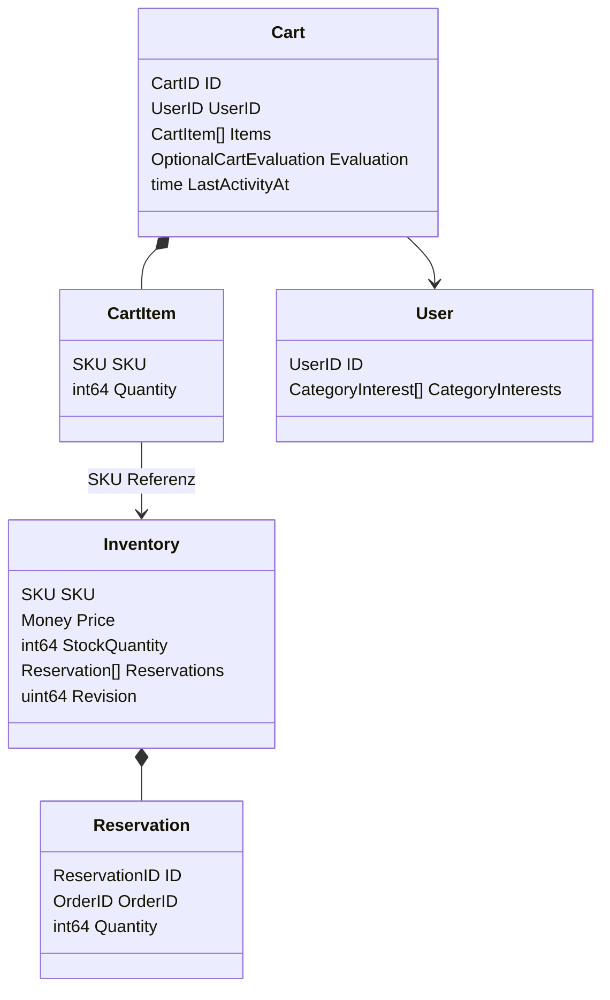
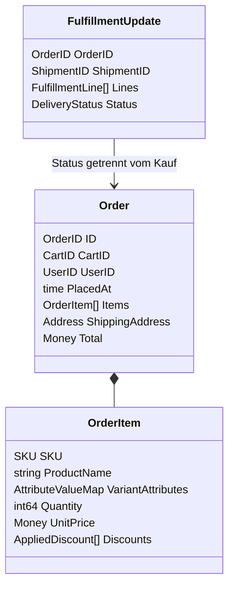

# Handel, Bewertung und Kauf-Snapshots

[Typenkatalog](type-model.md) enthält sämtliche Felder. Folgende Ergänzungen sind entschieden: Cart besitzt `Revision uint64`, `State CartState` (`open`, `checkingOut`, `ordered`, `expired`), `DefinitionVersion string`, `RuleSetVersion string` und `Checkout Optional[Checkout]`. Evaluation ergänzt `ID EvaluationID`, `CartRevision uint64`, `EvaluatedAt time.Time`, `InventoryRevisions map[SKU]uint64`, `RuleSetVersion string`. `EvaluationID` ist ein eigener Kennungstyp, kein CartID. Inventory führt die Variantenreferenz `SKU` als natürliche Root-Identität; kein künstliches generisches ID-Feld. In der Demo ein Preis pro Inventory; andere Währungen benötigen ausdrücklich neue Preis-Kontexte statt mehrfacher Bestandsführung.

| Root | Operation und Invariante |
| --- | --- |
| Inventory | Price ist nichtnegativer Bruttopreis, StockQuantity ≥ 0, positive Revision. AvailableQuantity = StockQuantity minus aktive Reservierungsmengen. Reserve nur beim Abschluss, Menge > 0 und ≤ verfügbar. SetStock unter aktive Reservierungen abweisen. Preisänderung erhöht Revision. |
| Cart | Add/SetQuantity/Remove auf SKU, Mengen 1..99; Add addiert bis 99, SetQuantity=0 ist Fehler, Remove löscht explizit. Jede SKU nur einmal. Maximal 50 Positionen. Jede Änderung invalidiert Bestätigung; keine Reservierung. LastActivityAt nur bei erfolgreicher Nutzeraktion, nicht beim Lesen/Retry. |
| User | ID plus eindeutige CategoryInterests mit Weight 0..1; vier vorbereitete Demo-Profile neutral/mobile/home/coffee. Gastidentität bleibt von geteilten Interessenprofilen getrennt. |
| Order | Mindestens eine Position; UserID/PlacedAt/Adresse/Versand/Zahlung und alle Preis-/Variantenwerte als unveränderliche Kopie. Ergänzung `CartID CartID`, `DefinitionVersion string`, `RuleSetVersion string`. Keine Mutation durch Katalogänderung oder Lieferfortschritt. |
| DiscountRule | Eigene versionierte Konfigurationsroot, weil Preiswirkung unabhängig veröffentlicht/gebunden wird. Ergänzung `Version uint64`, positive Amount, Haupt- und Zubehörprodukt verschieden, gültige Referenzen und Währung. Scope `pair` oder `order`, Demo pair. |

## Exakte Geld-/Rabattberechnung

Money.MinorUnits ist int64, Währung immer validiert. Keine Überläufe: Multiplikation/Summen vor Ausführung prüfen und AmountOverflow melden. Währungen niemals mischen, kein impliziter Wechselkurs. EUR hat 2 Minor Units, andere Währungen gemäß Register; negative Verkaufspreise/Rabatte/Versand unzulässig.

POC-Preise brutto, deutsche Demoartikel und Versand einheitlich 19 % USt. Andere Steuersätze sind als TaxAmount modellierbar, benötigen aber ausdrücklich konfigurierte Produktsatzzuordnung. Standardversand 490 EUR-Cent, Express 1490 EUR-Cent, keine versteckte Freigrenze. Lieferland DE, vollständige nichtleere Recipient/Street/City, PostalCode fünf ASCII-Ziffern. Keine reale Adressverifikation.

Subtotal = Summe Quantity × UnitPrice vor Rabatt. Eine pair-Regel nutzt min(Hauptmenge, kompatible Zubehörmenge) Paare; order-Regel höchstens einmal. Rabatt je Paar maximal Bruttopreis des Zubehörstücks. Zuordnung vollständig auf Zubehörposition, nie negativer Positionsbetrag. Bei mehreren passenden Regeln deterministisch RuleID aufsteigend; dieselbe Zubehöreinheit höchstens einer Regel zuordnen. Annehmen fügt gewählte Zubehör-SKU hinzu; Ablehnen ändert keinen Preis und keine Position. Entfernen eines erforderlichen Artikels entfernt sofort die abgeleitete Rabattwirkung. Profile verändern Regeln nicht.

EvaluatedCartItem.Discounts trägt die tatsächliche Positionszuordnung. CartEvaluation.Discounts ist eine aggregierte Sicht derselben Beträge nach RuleID, kein zweiter Abzug. Total = Subtotal − Summe Positionsrabatte + ShippingCost. TaxAmount aus jedem rabattierten Positions-Bruttobetrag und Versand separat: enthaltene Steuer = roundHalfUp(gross × rate / (100 + rate)), dann nach Rate summieren. Netto = Total − Taxes. Keine Rundung des Einzelstück-Steuerbetrags vor Mengenmultiplikation.

Beispiel: Smartphone 10000 + Zubehör 2000 Cent, ein Paar mit 500 Rabatt, Standard 490: Subtotal 12000, Rabatt 500, Total 11990; Steuer Smartphone 1597, Zubehör 239, Versand 78, zusammen 1914 Cent. Anzeige 119,90 EUR inkl. 19,14 EUR USt. Zwei Hauptgeräte + ein Zubehör ergeben weiterhin einen Rabatt, zwei passende Paare zwei Rabatte. Nullpreis ist zulässig, negativer Preis nicht.

## Reservierung und Bestellung

Reservation.ID aus OrderID+SKU deterministisch, positive Quantity. Reservierung ist nach verbindlicher Order dauerhaft gebunden bis simulierter Versand; kein unbeaufsichtigter TTL-Ablauf einer bestätigten Bestellung. Versand verbraucht StockQuantity und reduziert Reservierung atomar; Rückabwicklung/Storno ist spätere Funktion. Vor Bestellung gibt es keine Reservierung, auch während Kreditkarten-Simulation nicht. Abbruch vor Commit braucht daher keine Bestandskompensation. Details und Konkurrenzschutz: [Abschluss](../06-laufzeit/checkout.md).

OrderItem kopiert aufgelösten Produktnamen/Variantenattribute, Mengen, Einzelpreise und zugeordnete Rabatte; Order kopiert Summen, Steuer, Versand-/Zahlungswahl und Adresse. Das Readmodel darf keine späteren Live-Katalogwerte anstelle der Snapshots anzeigen. `packed`, `shipped`, `delivered` sind Liefermeldungen, keine Umschreibung des Kaufs.
