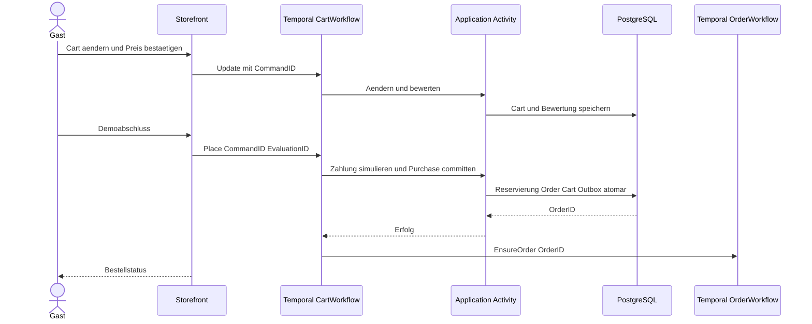

# 6 Laufzeitsicht

PostgreSQL hält fachliche Zustände und Idempotenz. Temporal hält langlebige Ablaufhistorie, Timer und Activitywiederholungen; OpenSearch hält abgeleitete Suchdaten. Keine globale Transaktion überspannt diese Systeme.

- [Temporal Cart und Order](temporal.md): Identität, Übergänge, Zeit und Wiederanlauf.
- [Bestellabschluss](checkout.md): Preisbestätigung, Zahlung, atomare Reservierung und Konkurrenz.
- [Outbox und CDC](projection.md): Commit, Projektion, Versionen, Löschung und Reindex.

Wenn die Prozessantwort nach Commit verloren geht, ergibt derselbe Command dieselbe OrderID. Der durable Outbox-Prozessauftrag stellt den Orderstart auch nach Workerabsturz sicher. Ablaufentscheidungen werden nicht aus wechselnder aktueller Konfiguration beim Replay neu erzeugt.
