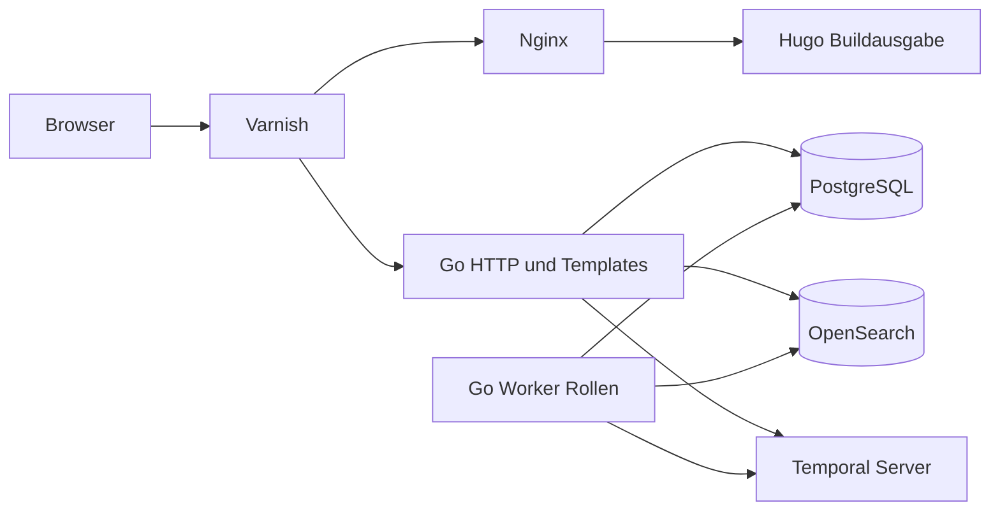

# 7 Verteilung und Laufzeit

Ziel ist ein reproduzierbarer lokaler Docker-Compose-Start mit echten Diensten. Diese Story liefert nur den Vertrag, keine Containerkonfiguration. Images und Versionen werden in der Implementierungsstory konkret gepinnt und nach Ausführung dokumentiert, keine ungeprüfte Kompatibilität behauptet.

| Dienst | Verantwortung / Netzgrenze |
| --- | --- |
| shop | Eine Go-Anwendung: HTTP-Storefront-/Backendadapter und Workerrollen für Temporal/CDC/Outbox; gleiche Binär-/Modulbasis, getrennte Prozesse zulässig |
| PostgreSQL | Fachzustand, Sessions, Idempotenz, Outbox, CDC Slot/Publication; persistentes Volume, wal_level=logical |
| Temporal Server | Echter Workflowserver, eigene Datenbank/Schemata getrennt vom Fachzustand; Worker verbindet TaskQueue shop |
| OpenSearch | Echter Suchindex, Alias shop-products; abgeleitet und reindexierbar |
| Hugo build | Erzeugt eigene Markdownrahmen/Assets, kein dauerhafter CMS-Dienst |
| Nginx | Serviert Hugoausgabe, verarbeitet SSI für gemeinsame statische Teile, leitet dynamische ESI-Marker weiter |
| Varnish | Öffentlicher lokaler Einstieg, ESI-Komposition und begrenzter gemeinsamer Fragmentcache |

## Feste lokale Vollstackreferenz

Für die vorab festgelegte lokale Leistungsabnahme dürfen die tatsächlich gepinnten OCI-Binärdateien zusätzlich ohne Dockerdaemon in unprivilegierten Bubblewrap-Prozessen laufen. Dies ist eine eigene technische Betriebsart, kein behaupteter Docker-Compose-Start. Sie benutzt dieselben Dienstversionen, fachlichen Konfigurationen, persistenten Zustände und öffentlichen Loopback-/Proxywege. Die Referenz umfasst beide getrennten Demo- und Benchmarkprojekte mit Go-Anwendung einschließlich Temporal-/CDC-/Outboxarbeit, PostgreSQL, echtem Temporalserver, OpenSearch samt gebündelter JVM/Lucene, Hugo-Inhaltsgenerierung, Nginx und Varnish. Hugo ist ein begrenzter Buildprozess, kein künstlich dauerhaft laufender Dienst.

Eine gemeinsame eigene systemd-Benutzerslice umfasst alle Referenzdienste sowie Testtreiber, hey, Collector und Hugo. Ihre wirksame Gesamthülle beträgt `cpu.max=400000 100000`, `memory.max=17179869184` und `memory.swap.max=0`. Alle zugehörigen Prozesse und Threads erhalten dieselbe CPUaffinität `0,2,4,6`; vier CPUs je Dienst sind kein zulässiger Ersatz für die gemeinsame Grenze. Weder ein externer Systemdockerdaemon noch außerhalb gestartete Dienstkinder dürfen diese Hülle umgehen. Es werden keine Hostrechte, Dockergruppen oder Systemdienste verändert. Die bestehende ursprüngliche Nutzerdemo bleibt außerhalb der getrennten Referenzzustände geschützt; ihre Konkurrenzlast und andere Hostlast werden offengelegt, nicht als exklusiv ausgeschlossen behauptet.

Der technische Demo-Testadapter wählt diese Betriebsart nur ausdrücklich. Persistenter App-/Infrastrukturrestart und echter Suchdienststop/-start bleiben Teil derselben fachlichen Verträge. Die tatsächlichen eigenen Units, Rootfs-/Zustandszuordnung, Dienstbereitschaft sowie unveränderte Prozess-/Thread-/Slicezugehörigkeit nach Restart sind vor der Leistungsabnahme unabhängig nachzuweisen. Ein erfolgreicher Prozessstart oder Compilebeleg ersetzt diese Ausführung nicht. Die bestehende Rechte-, Daten- und Loopbackgrenze gilt auch hier.

Öffentlicher Demoeinstieg bindet nur Loopback, keine öffentliche produktive Freigabe. /backend ausschließlich auf separatem lokalen Listener/Port und vom Storefronteinstieg nicht erreichbar, ohne Login wie beauftragt. Datenbank/Temporal/OpenSearch intern, Diagnoseports wenn nötig nur Loopback. Keine Dockergruppen-/Socket-/Daemonrechte durch Anwendung/Agent ändern.

Startreihenfolge über Healthchecks, wiederholbare Migrationen und idempotenten Demoimport. Shop readiness verlangt fachliche DB und Prozessannahme; Suchausfall ist degraded, kein Gesamtausfall. Persistente Volumes halten Käufe/Prozesshistory über Neustart. README der späteren Laufzeit beschreibt Start, Logs, Reset als explizite destruktive Demoaktion und den Gastpfad. Keine echte Payment-URL, keine externen Bestellungen.

Fehlende lokale Containerberechtigung ist fehlender Laufzeitnachweis und wird offen berichtet; reale CI-Dienstintegration kann Adapterfunktion belegen, ersetzt keinen behaupteten lokalen Compose-Start. Produktionsbackup, TLS/Publichosting, Hochverfügbarkeit und Secretbetrieb sind Folgearbeit vor echter Veröffentlichung.
