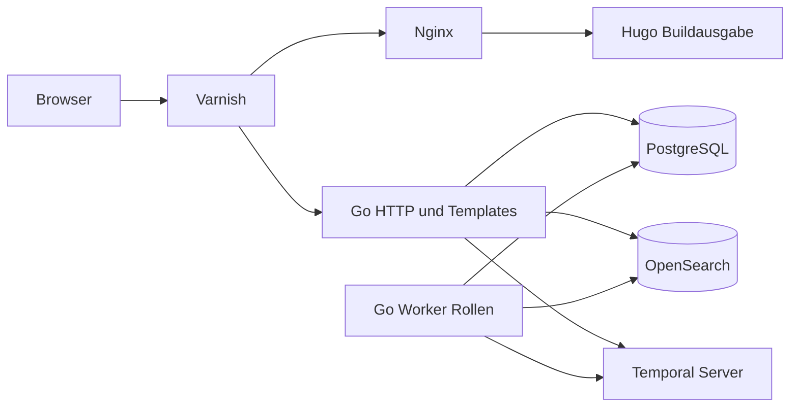

# 7 Verteilung und Laufzeit

Ziel ist ein reproduzierbarer lokaler Docker-Compose-Start mit echten Diensten. Diese Story liefert nur den Vertrag, keine Containerkonfiguration. Images und Versionen werden in der Implementierungsstory konkret gepinnt und nach Ausführung dokumentiert, keine ungeprüfte Kompatibilität behauptet.

| Dienst | Verantwortung / Netzgrenze |
| --- | --- |
| shop | Eine Go-Anwendung: HTTP-Storefront-/Backendadapter und Workerrollen für Temporal/CDC/Outbox; gleiche Binär-/Modulbasis, getrennte Prozesse zulässig |
| PostgreSQL | Fachzustand, Sessions, Idempotenz, Outbox, CDC Slot/Publication; persistentes Volume, wal_level=logical |
| Temporal Server | Echter Workflowserver, eigene Datenbank/Schemata getrennt vom Fachzustand; Worker verbindet TaskQueue shop |
| OpenSearch | Echter Suchindex, Alias shop-products; abgeleitet und reindexierbar |
| Hugo build | Erzeugt eigene Markdownrahmen/Assets, kein dauerhafter CMS-Dienst |
| Nginx | Serviert Hugoausgabe, verarbeitet SSI für gemeinsame statische Teile, leitet dynamische ESI-Marker weiter |
| Varnish | Öffentlicher lokaler Einstieg, ESI-Komposition und begrenzter gemeinsamer Fragmentcache |

Öffentlicher Demoeinstieg bindet nur Loopback, keine öffentliche produktive Freigabe. /backend ausschließlich auf separatem lokalen Listener/Port und vom Storefronteinstieg nicht erreichbar, ohne Login wie beauftragt. Datenbank/Temporal/OpenSearch intern, Diagnoseports wenn nötig nur Loopback. Keine Dockergruppen-/Socket-/Daemonrechte durch Anwendung/Agent ändern.

Startreihenfolge über Healthchecks, wiederholbare Migrationen und idempotenten Demoimport. Shop readiness verlangt fachliche DB und Prozessannahme; Suchausfall ist degraded, kein Gesamtausfall. Persistente Volumes halten Käufe/Prozesshistory über Neustart. README der späteren Laufzeit beschreibt Start, Logs, Reset als explizite destruktive Demoaktion und den Gastpfad. Keine echte Payment-URL, keine externen Bestellungen.

Fehlende lokale Containerberechtigung ist fehlender Laufzeitnachweis und wird offen berichtet; reale CI-Dienstintegration kann Adapterfunktion belegen, ersetzt keinen behaupteten lokalen Compose-Start. Produktionsbackup, TLS/Publichosting, Hochverfügbarkeit und Secretbetrieb sind Folgearbeit vor echter Veröffentlichung.
